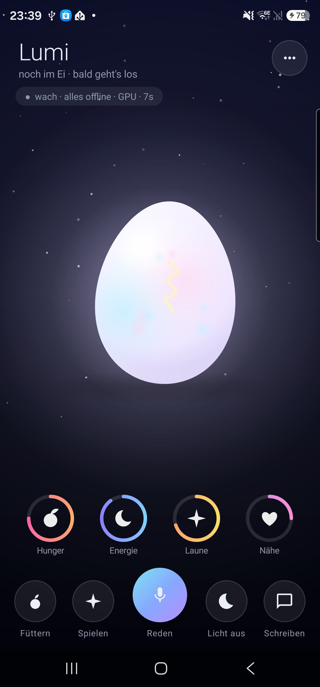
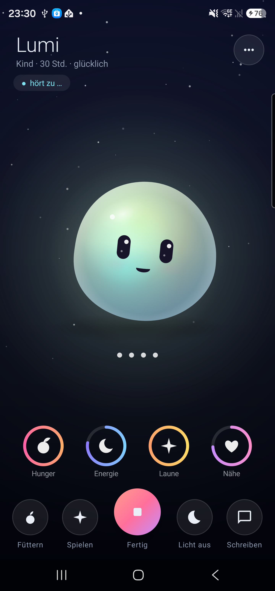
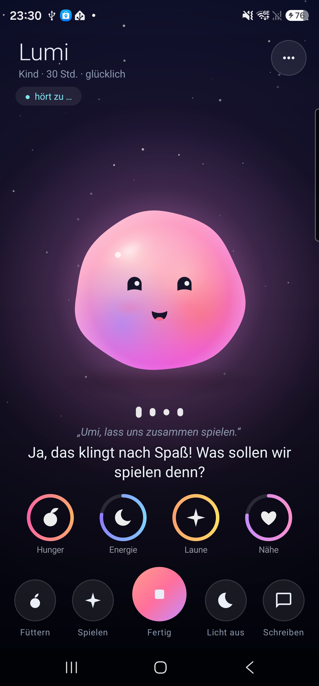
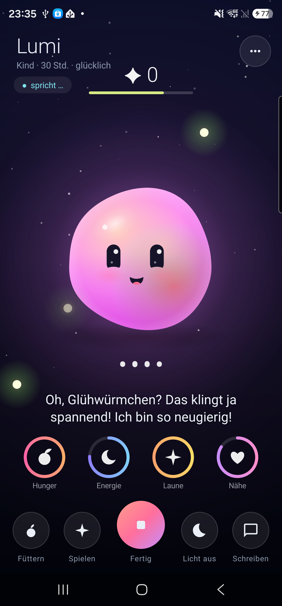
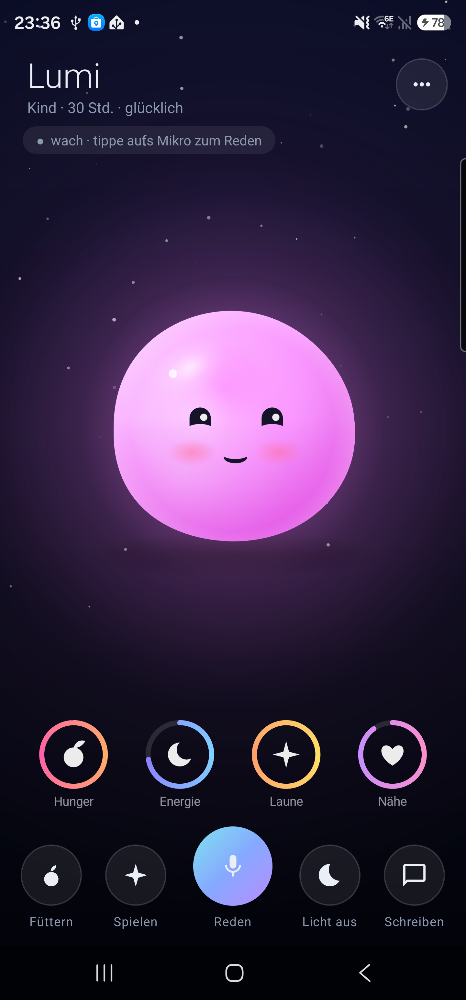
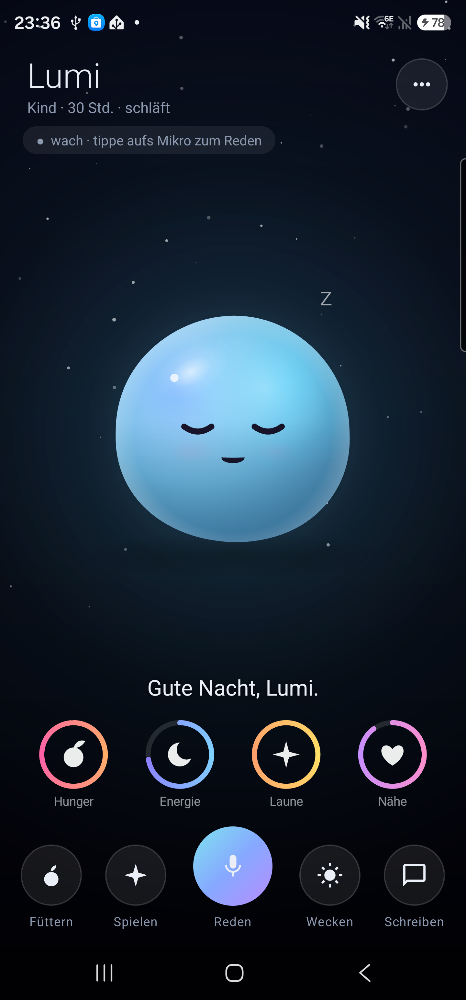
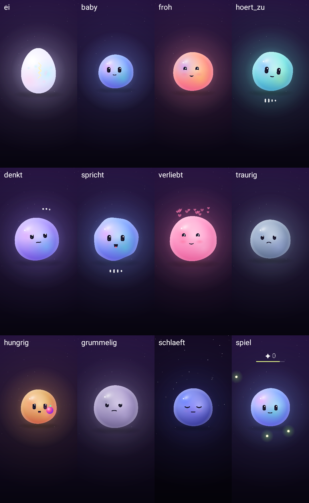

# Lumi – ein virtuelles Haustier, mit dem man reden kann

Lumi ist ein kleines, leuchtendes Wesen auf deinem Samsung S23. Es schlüpft aus einem Ei, hat Hunger,
wird müde, will spielen und gestreichelt werden, wächst über Tage vom Baby zum Erwachsenen, und
**man kann mit ihm sprechen**. Alles läuft **komplett offline** auf dem Handy. Ins Internet geht die
App nur ein einziges Mal, wenn du ihr „Gehirn“ herunterlädst (siehe unten); was du Lumi sagst,
verlässt das Handy nie. Plan für den Play Store: [docs/STORE-PLAN.md](docs/STORE-PLAN.md).

Die Sprach-Pipeline stammt aus dem Projekt *Gemma Voice*
(`C:\AI\Claude\gemma-voice\gemma-voice-avatar`) und wurde fürs Haustier umgebaut:

```
Mikrofon ─▶ Silero VAD ─▶ Whisper (de) ─▶ Gemma 4 E2B (LiteRT-LM, GPU) ─▶ Gefühls-Filter ─▶ Satz-Chunker ─▶ Piper ─▶ Lautsprecher
                                              ▲                                   │
                       <Zustand: hungrig, müde …> + Persona          😊 🥰 😴 … → Gesicht von Lumi (froh, verliebt, müde …)
```

Auf dem S23 Ultra (Android 17) gemessen: Gehirn geladen in 8 s (erster Start 14 s), Antwort ab
dem Ende des Satzes in 0,2–0,9 s, Gemma 27–32 Token/s auf der GPU.

| Ei | Zuhören | Spricht | Spielen | Gestreichelt | Schläft |
| --- | --- | --- | --- | --- | --- |
|  |  |  |  |  |  |

Alle Stimmungen am PC gerendert:



## Aussehen

Keine Pixelgrafik: Lumi ist ein weich wabernder, glasig glänzender Körper mit einem **lebendigen
Farbverlauf** im Inneren, ähnlich den Voice-Orbs moderner Assistenten. Dazu kommen zwei Kapselaugen
mit Lidern, Wangen und ein kleiner Mund.

* **Farbe = Gefühl**: froh (Pfirsich/Koralle), verliebt (Rosa), neugierig (Mint), müde (Indigo),
  hungrig (Orange), traurig (Graublau) usw. Jedes Ei bekommt eine eigene Farbverschiebung, kein Lumi
  sieht aus wie das andere.
* **Zuhören** zeigt vier Pillen unter Lumi, die mit dem Mikrofonpegel tanzen. **Denken** zeigt drei
  hüpfende Punkte. Beim **Sprechen** bewegt sich der Mund synchron zur Stimme, und der Körper pulsiert.
* Blinzeln, Blick folgt dem Finger, Hüpfen vor Freude, Herzchen beim Streicheln, „z“ beim Schlafen,
  Sternenhimmel bei Nacht, Glühwürmchen beim Spiel.
* Alles wird mit Canvas gezeichnet (`ui/PetView.kt`), ohne Bilder und ohne Shader. Es läuft also
  sicher auf jedem Gerät. **Fotos werden nicht gebraucht.**

## Was Lumi kann

| | |
| --- | --- |
| **Ei** | Antippen wärmt es (12×), sonst schlüpft es nach 3 Minuten von selbst. Danach fragt Lumi nach seinem Namen. |
| **Wachsen** | Baby (Tag 0) → Kind (ab 1 Tag) → Teenie (ab 3 Tagen) → Erwachsen (ab 7 Tagen). Die **Art zu reden ändert sich mit**: Babys brabbeln in 2–5 Wörtern, Kinder staunen, Teenies sind frech, Erwachsene weise. Auch die **Stimme wird mit dem Alter tiefer**. |
| **Bedürfnisse** | Hunger, Energie, Laune, Nähe. Sie sinken in Echtzeit, auch wenn die App zu ist. Ist Lumi erschöpft, schläft es von selbst ein und wacht ausgeschlafen wieder auf. |
| **Füttern** | Leuchtbeere (macht satt) oder Sternkeks (macht froh). Satte Lumis lehnen ab. |
| **Spielen** | „Glühwürmchen fangen“: 15 Sekunden, Glühwürmchen antippen. |
| **Streicheln** | Mit dem Finger über Lumi streichen ergibt Schnurren, Herzchen und Nähe. Antippen bringt es zum Kichern. |
| **Reden** | Mikro-Knopf: das Gespräch ist offen, ganz ohne Weckwort. Nach 30 s Stille schließt es von selbst. Dazwischenreden unterbricht Lumi (Barge-in). |
| **Schreiben** | Für leise Orte: Text eintippen, Lumi antwortet laut und als Untertitel. |
| **Gedächtnis** | „Ich heiße Lou“, „Ich mag Pizza“, „Meine Lieblingsfarbe ist blau“, „Ich habe einen Hund, der heißt Bello“, „Merk dir, dass …“. Lumi merkt sich das (⋯ → Erinnerungen, dort auch löschbar). „Vergiss alles“ funktioniert auch per Sprache. |
| **Sprachbefehle** | „Hier, iss was“, „Willst du einen Keks?“, „Lass uns spielen“, „Gute Nacht“ (Lumi sagt Gute Nacht und schläft ein), „Ich knuddel dich“, „Ich nenne dich ab jetzt Funkel“. |
| **Von selbst** | Lumi kommentiert, wenn es gegessen, gespielt hat, gewachsen ist oder du lange weg warst. |
| **Erinnerung** | Wenn die App zu ist, stellt Lumi einen lokalen Wecker. Rechtzeitig kommt dann „Lumi hat Hunger“. Kein Server, kein Push-Dienst. |

Im Menü **⋯**: Über Lumi · Erinnerungen · Gehirn importieren · Stimme · Stimmlage ·
**Zeitraffer** (1 Tag = 1 Stunde, praktisch zum Ausprobieren des Wachsens) · Geräusche ·
Erinnerungs-Mitteilungen · Neues Ei.

## Installieren

### 1. App bauen und aufs Handy

Handy per USB verbinden (Entwickleroptionen → USB-Debugging), dann im Projektordner:

```powershell
.\tools\install.ps1
```

Das baut `app\build\outputs\apk\debug\app-debug.apk` und installiert es mit `adb install -r -g`.
Daten und Modelle bleiben bei Updates erhalten. Eine fertige APK liegt auch als `Lumi-debug.apk` im
Projektordner.

### Auf andere Handys: `Lumi-1.0.apk`

`Lumi-1.0.apk` im Projektordner ist die Release-Version vom alten PC (`.\gradlew.bat :app:assembleRelease`,
signiert mit dem dortigen Debug-Schlüssel). Für den Play Store signiert Lumi mit einem eigenen
Upload-Schlüssel: `.\tools\new-upload-key.ps1` (einmal), dann `.\tools\build-release.ps1`, siehe
[docs/MINI-PC.md](docs/MINI-PC.md).

Die APK aufs Handy kopieren, antippen, „Unbekannte Apps installieren“ für den Dateimanager erlauben.

* Braucht ein **64-Bit-Android-Handy (arm64) ab Android 8**, sinnvoll mit **≥ 8 GB RAM** und ~4 GB
  freiem Speicher. Die GPU-Beschleunigung braucht OpenCL (Snapdragon/Exynos), sonst rechnet Gemma
  auf der CPU, langsamer.
* Die Modelle sind nicht in der APK. Auf einem anderen Handy kommen sie über ⋯ → *Gehirn
  importieren* (Modellordner oder `gemma-voice-models.zip` vorher aufs Handy kopieren). Das
  Kopier-Skript geht dort nicht: Die Release-Version ist nicht *debuggable*.
* Ohne Modelle lebt Lumi trotzdem (füttern, spielen, streicheln, wachsen), es kann nur nicht reden.

### 2. Das „Gehirn“ (Modelle, ≈ 3,2 GB)

Lumi braucht dieselben Modelle wie Gemma Voice. Eine App darf nicht in die Daten einer anderen
schauen, deshalb wird einmal kopiert. Am schnellsten geht das direkt auf dem Handy:

```powershell
.\tools\copy-models-from-gemmavoice.ps1
```

Das Skript reicht `files/models` per `run-as … tar | run-as … tar` von Gemma Voice an Lumi weiter
(auf dem S23 Ultra: 3,0 GB in 14 s; Gemmas GPU-Zwischenspeicher wird ausgelassen, Lumi baut ihn beim
ersten Start selbst).
Beide Apps sind selbst gebaut und damit *debuggable*, deshalb klappt das. Danach Lumi neu öffnen:
oben steht „wacht auf …“ und nach rund 7 s „wach · alles offline“.

**Ohne PC, über das Internet:** Lumi bietet beim ersten Start (und unter ⋯ → *Gehirn*) an, das Gehirn
einmalig herunterzuladen: Gemma 4 E2B, Whisper small, Silero VAD und die Stimme Kerstin (CC0) mit
Phonemisierer, zusammen 3,05 GB, direkt von Hugging Face. Alle 363 Dateien sind auf feste Commits
festgelegt (`app/src/main/assets/brain_manifest.tsv`, erzeugt von `tools/make_brain_manifest.py`), große
Dateien werden per SHA-256 geprüft, ein Abbruch setzt beim nächsten Mal an derselben Stelle fort. Danach
baut die App keine Verbindung mehr auf. Test gegen die echten Server:
`.\gradlew.bat :app:testDebugUnitTest -Plumi.net=true --tests "com.lou.lumi.BrainDownloadNetTest"`.

**Ohne PC, aus Dateien:** in Lumi ⋯ → *Gehirn* → *Ordner / ZIP …* → *Ordner wählen* (z. B. der Modellordner unter
`Download/`) oder *ZIP wählen* (`gemma-voice-models.zip`). Das ist derselbe Importer wie in Gemma Voice.

Erwartete Struktur (wie bei Gemma Voice):

```
files/models/vad/silero_vad_v5.onnx
files/models/asr/small-encoder.int8.onnx, small-decoder.int8.onnx, small-tokens.txt
files/models/tts/de/…onnx + tokens.txt + espeak-ng-data/   (weitere Stimmen in Unterordnern)
files/models/tts/en/…
files/models/gemma/gemma-4-E2B-it.litertlm                 (NICHT die -gpu-Variante, siehe Gemma-Voice-README)
```

**Stimme:** Ohne eigene Wahl nimmt Lumi eine helle Stimme (Eva K / Kerstin), falls installiert,
sonst Thorsten. Die Tonhöhe hängt vom Alter ab (Baby ×1,30 … Erwachsen ×1,04). Piper rendert
langsamer und der Lautsprecher spielt entsprechend schneller ab. So bleibt das Tempo gleich, nur die
Stimme wird heller. ⋯ → *Stimmlage* verschiebt das insgesamt.

## Bauen / Testen am PC

Voraussetzungen wie bei Gemma Voice: JDK 17, Android SDK (compileSdk 35), Gradle-Wrapper 8.10.2,
AGP 8.7.3, Kotlin 2.4.20, nur `arm64-v8a`.

```powershell
.\gradlew.bat :app:assembleDebug
.\gradlew.bat :app:testDebugUnitTest
```

Die Tests prüfen die Regeln (Bedürfnisse, Schlüpfen, Wachstum, Schlaf, Erinnerungen), den
Gefühls-Tag-Filter auf dem Token-Strom, die Spracherkennung von Befehlen und Fakten, die Persona
und den Modell-Import. Dazu **rendert `PetRenderTest` Lumi in allen Stimmungen als PNG**
(Robolectric Native Graphics) nach `app\build\renders\`. So lässt sich das Aussehen ohne Handy prüfen.

### Test-Schalter per adb

Text mit Leerzeichen muss für die Shell auf dem Handy noch einmal in einfache Anführungszeichen,
sonst kommt nur das erste Wort an.

```powershell
adb shell "am start -n de.tamalumi.app/com.lou.lumi.ui.MainActivity --ez hatch true"            # sofort schlüpfen
adb shell "am start -n de.tamalumi.app/com.lou.lumi.ui.MainActivity --ei age_hours 80"          # Teenie
adb shell "am start -n de.tamalumi.app/com.lou.lumi.ui.MainActivity --es needs 15,80,60,40"     # Hunger,Energie,Laune,Nähe
adb shell "am start -n de.tamalumi.app/com.lou.lumi.ui.MainActivity --es say 'Hallo, ich heiße Lou und ich mag Pizza'"
adb shell "am start -n de.tamalumi.app/com.lou.lumi.ui.MainActivity --ez talk true"             # Gespräch öffnen (Mikro)
adb shell "am start -n de.tamalumi.app/com.lou.lumi.ui.MainActivity --es speak 'Lumi, hast du Lust zu spielen?'"   # über Whisper
adb shell "am start -n de.tamalumi.app/com.lou.lumi.ui.MainActivity --es feed cookie --ez play true"
adb logcat -s Lumi Lumi.LLM Lumi.STT Lumi.TTS Lumi.PET Lumi.UI
```

Im Log steht pro Antwort die Rohausgabe von Gemma und das erkannte Gefühl, z. B.
`Gefühl: SAD` / `LLM done: ttft=173ms … 😢 Oh no, das ist schade. Warum bist du traurig?`.

## Projektaufbau

| Datei | Aufgabe |
| --- | --- |
| `pet/PetModel.kt`, `pet/PetEngine.kt` | Zustand und Regeln (reines Kotlin, getestet): Bedürfnisse, Stufen, Stimmung, Charakter, Erinnerungs-Vorhersage |
| `pet/PetKeeper.kt` | besitzt den Zustand (StateFlow), speichert ihn, verteilt Reaktionen |
| `pet/CareReminder.kt` | lokaler Wecker + Benachrichtigung |
| `brain/PetBrain.kt` | die Sprach-Kaskade (aus Gemma Voice): Gespräch, Barge-in, Stimme, spontane Kommentare |
| `brain/Persona.kt` | Systemprompt (Name, Alter, Charakter, Erinnerungen) + `<Zustand …>`-Zeile pro Nachricht |
| `brain/EmotionTag.kt` | liest das Gefühls-Emoji am Antwortanfang (oder `[froh]`, ein kopiertes `<Zustand …>`), schneidet es aus Text und Sprache und steuert damit das Gesicht; ohne Markierung wird das Gefühl aus dem ersten Satz geschätzt |
| `brain/Understanding.kt` | Sprachbefehle, Namen und Fakten aus dem Gesagten |
| `ui/PetView.kt` | Lumi selbst (Körper, Gesicht, Partikel, Futter, Spiel, Touch) |
| `ui/NeedsView.kt`, `ui/Palette.kt`, `ui/SoundFx.kt` | Bedürfnis-Ringe, Farbwelten, synthetische Geräusche |
| `voice/*` | aus Gemma Voice übernommen: AudioIn/Out, Whisper, Piper, LiteRT-LM, Modell-Import |

## Optional: Bilder mit ChatGPT

Für die App selbst sind keine Bilder nötig. Wer ein schickes Bild für den Startbildschirm des
Handys, ein Hintergrundbild oder ein Poster von Lumi möchte, kann diesen Prompt nehmen:

> Create a square 1024×1024 image of a cute, modern digital creature called "Lumi": a soft,
> glossy, slightly squishy glowing orb (mochi-like, a little wider at the bottom) with a living
> mesh gradient inside – peach, coral, soft pink, lilac and a hint of mint – like the voice orb of a
> modern AI assistant. Two simple dark capsule-shaped eyes with a tiny white highlight each, faint
> pink blush on the cheeks, a tiny content smile. A soft colored glow around it and a gentle
> shadow below. Background: deep night-blue to violet gradient with a few faint stars. Minimal,
> premium, Apple/One UI style, smooth 3D-ish lighting, no text, no pixel art, no outlines, centered.

## Lizenz

Lumi ist freie Software unter der **GNU General Public License v3.0** – siehe [LICENSE](LICENSE).
Du darfst Lumi nutzen, weitergeben und verändern; wer eine veränderte Version weitergibt, muss deren
Quellcode ebenfalls unter der GPL-3.0 offenlegen. Grund für die GPL: Die Sprachausgabe nutzt eSpeak NG
(GPL-3.0), das fest in sherpa-onnx steckt. Alle Bausteine anderer Projekte mit ihren Lizenzen:
[THIRD_PARTY_NOTICES.md](THIRD_PARTY_NOTICES.md). Die App zeigt beides unter ⋯ → *Lizenzen & Quellcode*.
